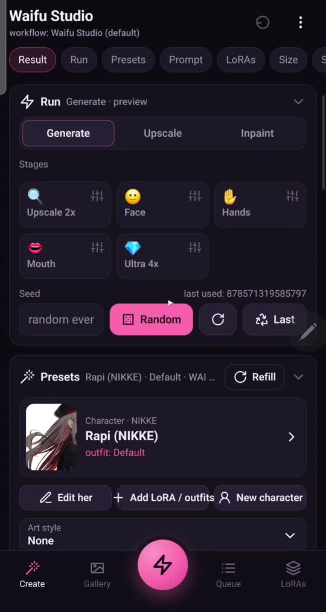
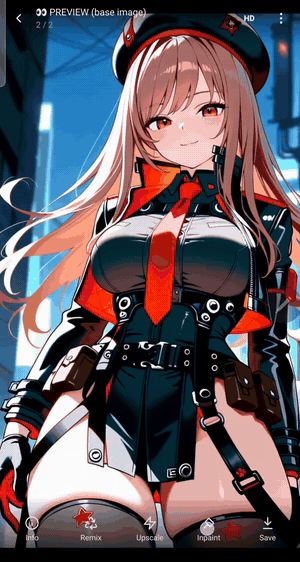
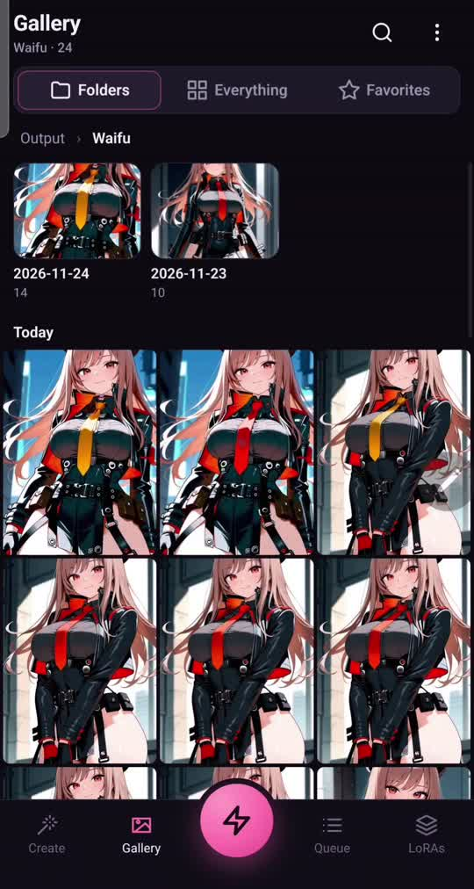
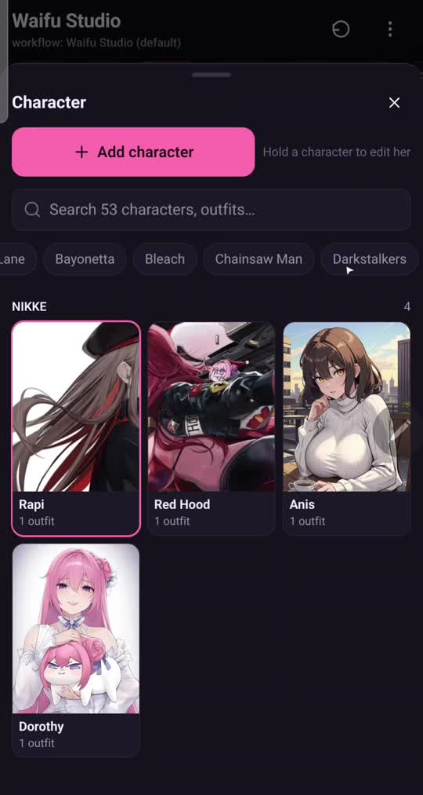
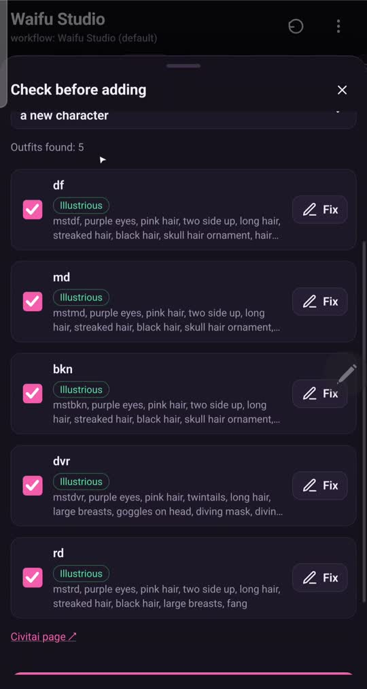

# Waifu Studio for ComfyUI

A phone app for ComfyUI and an anime workflow to go with it. You pick a character, an outfit, an art style and a
model, then generate. You have upscaling, face, hand and mouth detailers, inpainting, multiple model presets, character presets, easy lora integration and more!
And all of it can be controlled on your mobile device from anywhere in the world!

  
  &nbsp;
  

## Phone app

Open `http://<your-pc>:8188/waifu/m/` in your phone's browser. You don't install anything on the phone.

- **Create**: character, outfit, art style and model pickers, a prompt editor with tag autocomplete, and one-tap
  switches for each stage (Upscale 2x, Face, Hands, Mouth, Ultra 4x). You see a live preview while it samples.
- Found a preview you like? Tap *Use seed*, turn on the stages you want and generate again. Only the new stages run.
- **Upscale** and **Inpaint** work on any image. You paint the inpaint mask with your finger and pinch to zoom.
- **Gallery** shows your whole output folder: folders, favorites, search by prompt text, pinch to change the
  number of columns, full-screen viewer with zoom, before/after slider, image info, and Remix (loads the
  settings that made an image). Deleting moves files to a trash folder, with undo.
- **Queue** shows live progress and waiting jobs, including ones started on the PC. You can cancel jobs here.
- **LoRA browser** with Civitai preview pictures and trigger words.
- **All nodes** lets you edit every setting of every node in the workflow.
- **Models & downloads** lists the model files the presets need and downloads the missing ones.
- The Android back button works, and you can install the page as an app (see Phone access).

 

## Install

Tested with ComfyUI 0.32 on Windows (portable build), with an RTX 3090.

1. In `ComfyUI/custom_nodes/`, run `git clone https://github.com/MrPizza-0/easy-waifu-studio`, or use
   ComfyUI Manager's "Install via Git URL" with the same link. After a git clone, also install the one Python
   package it needs with ComfyUI's Python. On the Windows portable build, from the `ComfyUI_windows_portable` folder:
   `python_embeded\python.exe -m pip install -r ComfyUI\custom_nodes\easy-waifu-studio\requirements.txt`
2. Install these node packs with ComfyUI Manager: rgthree-comfy, ComfyUI-KJNodes, ComfyUI-Impact-Pack,
   ComfyUI-Impact-Subpack and ComfyUI-Custom-Scripts. Custom-Scripts is optional. It shows the final prompt on
   the PC; tag autocomplete works without it.
3. Restart ComfyUI. On the PC, load `workflow/Waifu Studio.json`, or go straight to the phone app.
4. In the phone app, open Output & advanced > Models & downloads. Paste your Civitai API key (civitai.com >
   Account settings > API keys) and download the files you need. The key is saved on your PC in
   `ComfyUI/user/waifu_studio.json` and is only sent to Civitai.

The default model is WAI-NSFW-Illustrious v14 (SDXL). An Anima model preset (Nova 3DCG) is included too.

## Phone access

ComfyUI has no password. Anyone who can reach its port can use it, see your images and queue jobs, so don't
port-forward it to the internet.

Use [Tailscale](https://tailscale.com) (free) on the PC and the phone. Then either:

- start ComfyUI with `--listen` and open `http://<pc-tailscale-ip>:8188/waifu/m/`, or
- run `tailscale serve --bg 8188` on the PC (no `--listen` needed) and open
  `https://<pc-name>.<tailnet>.ts.net/waifu/m/`. Over HTTPS, Chrome offers "Install app" and the page runs full-screen.

You don't have to type the address. On Windows, Waifu Studio puts an icon in the system tray while ComfyUI runs.
Click it (or right-click > Connect phone) and a page opens with a QR code: scan it with your phone camera. The page
picks an address your phone can reach, and tells you what to change if there isn't one. The same page is at
`http://127.0.0.1:8188/waifu/connect`. To hide the tray icon, add `"tray": false` to `ComfyUI/user/waifu_studio.json`.

## Characters and outfits

The included characters are pre trained in the model. No loras are included.

To add a character from a Civitai LoRA, in the phone app:

1. Open the character list and tap + Add character > Find character on Civitai.
2. Type the character's name or paste the link to the LoRA's Civitai page.
3. Waifu Studio reads the page and fills in the name, one outfit per LoRA version, the trigger words, the model
   type (Anima or Illustrious) and a picture. If the character already exists, the new outfits are added to it.
4. Look over the list. Untick outfits you don't want, tap Fix to change words, then tap Add and download.

 

The importer gets things wrong sometimes, so everything can be changed afterwards. Edit opens an editor for
the name, picture and outfits. For each outfit you can set the LoRA, its strength and the words, and the trigger
words from the LoRA page show up as buttons you tap to add. If you change one of the 51 built-in characters, you
can reset it to the original. You can share characters as small pack files. A pack has the Civitai links,
not the LoRA files.

Your characters are saved in `ComfyUI/user/waifu_studio/`, so updating Waifu Studio doesn't touch them.
When you switch between an Anima and an Illustrious model, each character switches to its LoRA for that model.

 

## Art styles

No style LoRAs are included. Add the ones you like under Art style > + Add style: search Civitai or paste a
link. You get one style per model type, with the creator's trigger words and suggested strength filled in.
Edit style changes the words, the strength or the LoRA file.

When you switch to another character, style or model, the previous one's LoRAs are removed from the LoRA list.
If you'd rather have them only switched off, change that in Output & advanced.

## Models

Two model presets are included: WAI-NSFW-Illustrious v14 and Nova 3DCG (Anima). To add another model, open
the Presets card and tap Add model:

- **Find a model on Civitai**: search by name or paste the link to the model's Civitai page. Pick the version you
  want. Waifu Studio fills in the steps, CFG, sampler, scheduler, quality words and negative prompt from the settings
  the creator recommends on that page, and uses the included preset's values for anything the page doesn't say.
  Check them, then tap Add and download.
- **Create preset**: for a model file you already have. Pick the file and set the values yourself.

Illustrious, NoobAI, SDXL and Anima models work. Pony, SD 1.5, Flux and v-pred models don't work with this
workflow, and the search marks them "not usable here".

Edit model changes any value of the selected preset, including the model file. Your model presets are saved in
`ComfyUI/user/waifu_studio/models.json`, so updating Waifu Studio doesn't touch them.

## Credits

Character pictures are linked from Safebooru and Civitai and are not part of this repository. LoRAs belong to
their Civitai creators. The tag autocomplete list comes from ComfyUI-Custom-Scripts by pythongosssss.

Copyright (C) 2026 MrPizza-0. License: GPL-3.0 (see `LICENSE`). You may use, change and share it, but anything
you share that is based on it must stay under GPL-3.0, with its source code and this copyright notice.
Versions published before November 26, 2026 were released under the MIT license.
